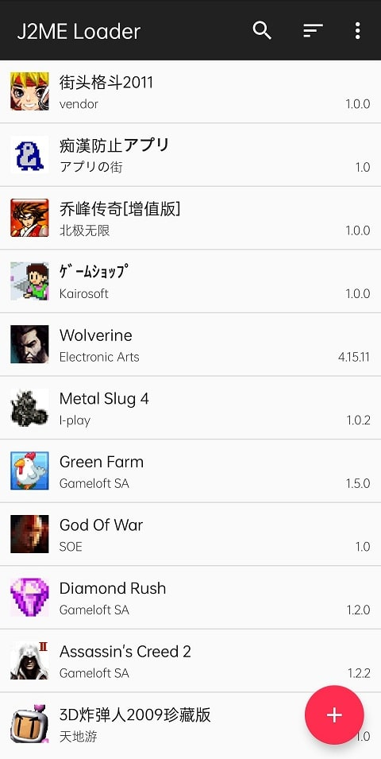
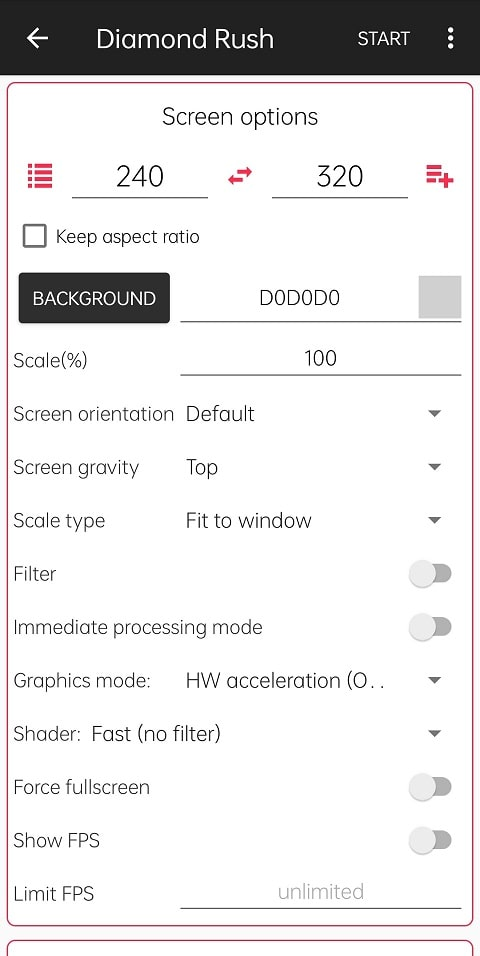
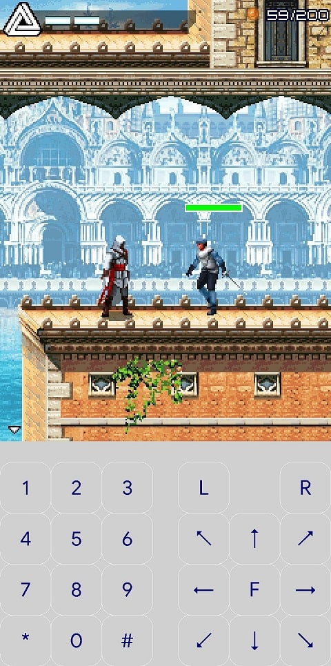

# J2ME-Bloat

J2ME-Bloat, eski Java ME (J2ME) oyunlarını ve uygulamalarını modern Android cihazlarda çalıştıran bir emülatördür. [J2ME Loader](https://github.com/nikita36078/J2ME-Loader) tabanlıdır.

*English: J2ME-Bloat is a Java ME emulator for Android based on J2ME Loader. Add your own games as JAR/JAD files, a folder or a ZIP archive. See [English quick guide](#english-quick-guide) below.*

<p>
  
  
  
</p>

## Özellikler

- 2D ve 3D J2ME oyunları (Mascot Capsule 3D dahil)
- JAR/JAD dosyalarından, bir klasörden veya **ZIP arşivinden toplu içe aktarma**
- İlerleme çubuklu, iptal edilebilen içe aktarma; hatalı dosyaların listesi kopyalanabilir
- Material 3 tasarımlı, açık/koyu temalı oyun kütüphanesi
- Özelleştirilebilir sanal klavye ve dokunmatik kontroller
- Her oyun için ayrı ekran, ölçekleme ve kontrol ayarları

## Kurulum

1. [Releases](https://github.com/mesflit/J2ME-Bloat/releases/tag/continuous) sayfasından en son `.apk` dosyasını indir.
2. Dosyayı aç ve kur. Android "bilinmeyen kaynaklar" izni isterse, dosyayı açtığın uygulamaya (tarayıcı, dosya yöneticisi) izin ver.
3. Yeni sürümler aynı imzayla yayınlanır; yeni APK'yı doğrudan eskisinin üzerine kurabilirsin. Oyunların ve ayarların silinmez.

> **J2ME Loader'dan veya eski J2ME-Bloat sürümlerinden geçiş:** Paket adı artık `com.mesflit.j2mebloat`. Bu yüzden eski sürümler ayrı bir uygulama olarak görünür. Eskisini kaldırıp oyunlarını yeniden ekleyebilir ya da *Ayarlar → Import/export data* seçeneğiyle eski uygulamadan dışa aktarıp yenisine içe aktarabilirsin.

## Oyun ekleme rehberi

J2ME-Bloat içinde oyun gelmez; kendi sahip olduğun oyun dosyalarını eklersin. Ana ekranda sağ alttaki **Oyun ekle** düğmesine dokun ve bir yöntem seç.

### 1. JAR / JAD dosyaları

Bir veya birden fazla dosya seç. Birden fazla dosya seçersen hepsi sırayla kurulur.

- `.jar` dosyası tek başına yeterlidir.
- Oyunun `.jad` dosyası da varsa ikisini birlikte seç. J2ME-Bloat eşleşen JAR'ı kendisi bulur.
- `.kjx` dosyaları da desteklenir.

### 2. ZIP arşivi

Oyunlarını tek bir `.zip` dosyasında topladıysan arşivi seçmen yeterli.

- Arşivin içindeki tüm `.jar`, `.jad` ve `.kjx` dosyaları bulunur ve kurulur. Alt klasörler de taranır.
- Arşiv içindeki arşivler (örneğin `oyunlar.zip` içinde `oyun1.zip`) de açılır.
- Dosyalar önce geçici olarak çıkarılır, kurulum bitince silinir. Büyük arşivler için cihazda arşiv boyutu kadar boş alan olmalı.
- Dosya yöneticisinde bir ZIP'e dokunup "J2ME-Bloat ile aç" dersen de aynı şekilde içe aktarılır.

### 3. Klasör

Oyunların telefonda bir klasördeyse klasörü seç. Klasör ve tüm alt klasörleri taranır; içerideki ZIP arşivleri de açılır.

### İçe aktarma sırasında

- İlerleme çubuğu kaç oyunun kurulduğunu gösterir. Ekran bu sırada kapanmaz.
- **İptal** düğmesi, o an kurulan oyun bitince işlemi durdurur. O ana kadar kurulanlar kütüphanede kalır.
- Bitince kurulan ve başarısız olan oyun sayısı gösterilir. **Hatalı listeyi kopyala** ile başarısız dosyaların adlarını panoya alabilirsin.

## Oyunları kullanma

- Oyunu başlatmak için kütüphanede ona dokun.
- Uzun basarak menüyü aç: **Ayarlar** (çözünürlük, ölçekleme, kontroller, klavye düzeni), **Yeniden adlandır**, **Kısayol oluştur**, **Yeniden kur** ve **Sil**.
- Üst çubuktaki düğmelerle arama yapabilir, liste/ızgara görünümü arasında geçebilir ve sıralamayı değiştirebilirsin.

### Sık karşılaşılan sorunlar

| Sorun | Çözüm |
|---|---|
| Oyun çok yavaş | Oyun ayarlarında filtrelemeyi kapat. |
| Görüntü titriyor | "Immediate processing mode" seçeneğini aç. |
| Ekran çok küçük/büyük | Oyun ayarlarından ekran çözünürlüğünü oyunun gerçek çözünürlüğüne (örn. 240×320) ayarla. |
| Güncelleme "uygulama yüklenmedi" hatası veriyor | Elindeki sürüm farklı bir anahtarla imzalanmış. Bir kez kaldırıp yeni sürümü kur; sonraki güncellemeler üzerine kurulur. |
| ZIP'ten hiç oyun bulunamadı | Arşivde `.jar`/`.jad`/`.kjx` dosyası olduğundan emin ol. RAR ve 7z desteklenmez; önce ZIP'e çevir. |

## Derleme

Gereksinimler: Android SDK, Android NDK, JDK 21.

```sh
# Hata ayıklama sürümü
./gradlew :app:assembleOpenDebug

# İmzalı sürüm (imzalama ayarları için aşağıya bak)
./gradlew :app:assembleOpenRelease
```

Çıktılar `app/build/outputs/apk/` altında oluşur.

Yerel imzalı derleme için proje kök dizinine `keystore.properties` dosyası koy (bu dosya git'e eklenmez):

```properties
storeFile=/tam/yol/release.jks
storePassword=...
keyAlias=...
keyPassword=...
```

## Otomatik sürümler (GitHub Actions)

`master` dalına her gönderimde `.github/workflows/release.yml` APK'yı derler ve [continuous](https://github.com/mesflit/J2ME-Bloat/releases/tag/continuous) sürümüne yükler.

Android, bir güncellemeyi ancak önceki sürümle **aynı anahtarla** imzalanmışsa üzerine kurar. Daha önce anahtar tanımlı olmadığı için her derleme rastgele bir debug anahtarıyla imzalanıyordu ve güncellemeler bu yüzden kurulmuyordu. Artık iş akışı sabit bir anahtar ister; anahtar yoksa ya da APK debug anahtarıyla imzalanmışsa derleme hata verir. Ayrıca sürüm kodu her commit'te artar.

Kurulum tek seferliktir:

1. Bir imza anahtarı oluştur (JDK ile gelen `keytool` ile). Bu dosyayı ve şifreyi **güvenli bir yerde sakla**; kaybedersen kullanıcılar bir sonraki güncellemeyi üzerine kuramaz.

   ```sh
   keytool -genkeypair -v -keystore release.jks -alias j2mebloat \
     -keyalg RSA -keysize 4096 -validity 10000 -storetype PKCS12
   ```

2. Anahtarı base64'e çevir:

   ```sh
   base64 -w0 release.jks > release.jks.b64      # Linux
   base64 -i release.jks -o release.jks.b64      # macOS
   ```

3. GitHub'da depo → **Settings → Secrets and variables → Actions → New repository secret** ile şunları ekle:

   | Secret | Değer |
   |---|---|
   | `SIGNING_KEY` | `release.jks.b64` dosyasının içeriği |
   | `KEY_STORE_PASSWORD` | Anahtar deposu şifresi |
   | `KEY_ALIAS` | `j2mebloat` (veya seçtiğin takma ad) |
   | `KEY_PASSWORD` | Anahtar şifresi (PKCS12'de depo şifresiyle aynı; boş bırakılabilir) |

4. **Actions → Automated CI builds → Run workflow** ile derlemeyi başlat. Özet sayfasında APK'nın imza parmak izi (SHA-256) görünür; her sürümde aynı olmalıdır.

Daha önce `SIGNING_KEY` ve `KEYSTORE_PROPERTIES` secret'larını kullandıysan onlar da çalışmaya devam eder.

## English quick guide

- **Install:** download the latest APK from [Releases](https://github.com/mesflit/J2ME-Bloat/releases/tag/continuous). New builds install over old ones.
- **Add games:** tap **Add games** and pick JAR/JAD files, a ZIP archive (nested archives and subfolders are scanned) or a folder. Imports show progress, can be cancelled, and list any files that failed.
- **Play:** tap a game to start it; long-press for per-game settings, rename, shortcut, reinstall or delete.
- **Automatic releases:** add the `SIGNING_KEY` (base64 keystore), `KEY_STORE_PASSWORD`, `KEY_ALIAS` and `KEY_PASSWORD` repository secrets. Every build is then signed with the same key, so updates install over each other.

## Yasal not

J2ME-Bloat içinde oyun bulunmaz. Oyunlar geliştiricilerinin ve yayıncılarının mülküdür; yalnızca sahip olduğun veya kullanma hakkın olan oyunları ekle.

## Lisans ve teşekkür

Uygulama kaynak kodu Apache License 2.0 ile lisanslanmıştır (bkz. [LICENSE](LICENSE)). J2ME-Bloat, Nikita Shakarun ve katkıda bulunanların [J2ME Loader](https://github.com/nikita36078/J2ME-Loader) projesine dayanır.
